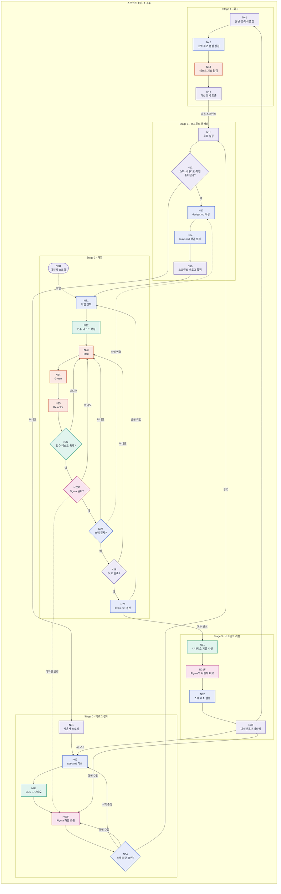

# 4DD 스프린트 워크플로우

스프린트 한 바퀴는 **Stage 0~4**로 나뉘고, 각 스테이지 안에 노드가 있습니다.

```
스프린트 (한 바퀴, 1~4주)
 └─ 스테이지 (Stage 0~4)
     └─ 노드 (N01, N26F …)
```

## 노드 맵

- 사각형: 작업 노드
- 마름모: 판단 노드
- 둥근 모양: 반복 노드 (N2D 데일리 스크럼)
- 점선: 스펙이나 디자인을 바꿔야 해서 앞 스테이지로 돌아가는 경로



색: 파랑 SDD · 초록 BDD · 분홍 Figma · 주황 TDD · 보라 스크럼

## 되돌림 경로

| 지점 | 조건 | 돌아가는 곳 | 의미 |
|---|---|---|---|
| N04 | 스펙·화면 미승인 | N02 / N03F | 스펙이나 프로토타입을 고쳐서 다시 리뷰 |
| N12 | 스펙·시나리오·화면 없음 | N01 | 준비 안 된 스토리는 스프린트에 넣지 않음 |
| N26 | 인수 테스트 실패 | N23 | TDD 반복 |
| N26F | Figma와 불일치 | N23 / N03F | 화면을 고치거나, 디자인을 바꿔야 하면 프로토타입으로 |
| N27 | 설계와 불일치 | N23 / N13 | 코드를 고치거나, 스펙을 바꿔야 하면 설계로 |
| N28 | DoD 미충족 | N23 | 완료 기준을 채울 때까지 작업 |
| N33 | 피드백 | N02 / N03F | 스펙이나 화면을 갱신하고 새 요구를 백로그로 |
| N44 | 회고 끝 | N11 | 다음 스프린트 시작 |
