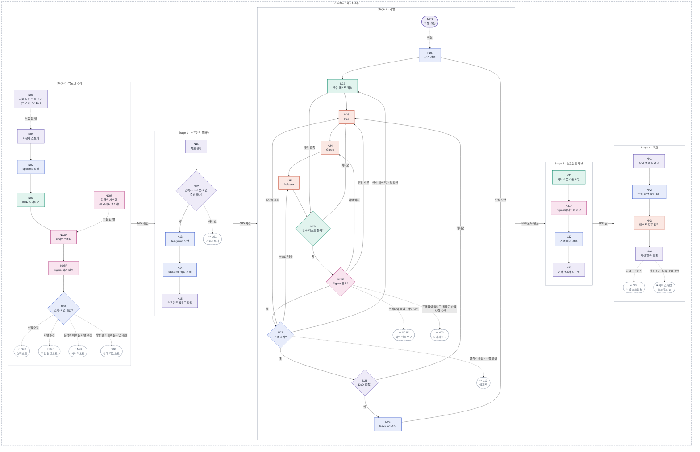

# 4DD 스프린트 워크플로우

스프린트 한 바퀴는 **Stage 0~4**로 나뉘고, 각 스테이지 안에 노드가 있습니다.

```
스프린트 (한 바퀴, 1~4주)
 └─ 스테이지 (Stage 0~4)
     └─ 노드 (N01, N26F …)
```

## 노드 맵

- 사각형: 작업 노드
- 마름모: 판단 노드
- 둥근 모양: 반복 노드 (N2D 진행 요약)
- 스테이지 사이 화살표: Stage 0 → 1 → 2 → 3 → 4 진행 순서
- 점선 화살표: 매일 반복(N2D), 프로젝트 처음에 한 번만 거치는 경로(N00, N00F)
- 점선 상자 `↩ N02`: 앞 노드로 돌아가는 되돌림. 긴 화살표를 거꾸로 그으면 그림 순서가 뒤섞여서, 돌아갈 곳을 표지로 적습니다. Stage 2의 TDD 반복(→ N23, N24, N21)만 화살표로 그립니다
- 점선 상자 `↪ N22`: 개발 중에 앞 스테이지로 돌아갔던 작업이 다시 승인받고 원래 작업으로 돌아오는 곳 ([개발 중 앞 스테이지로 돌아간 작업](#개발-중-앞-스테이지로-돌아간-작업))
- 점선 상자 `■ 서비스 완성`: 완성 조건을 모두 채우면 프로젝트를 마치는 곳 ([서비스 완성](#서비스-완성))
- 분홍 Figma 노드(N00F, N03W, N03F, N26F, N31F): 화면이 있는 작업 유형에서만 거칩니다. 화면이 없으면 건너뜁니다 ([화면이 없는 작업 유형](#화면이-없는-작업-유형))



색: 파랑 SDD · 초록 BDD · 분홍 Figma · 주황 TDD · 보라 스크럼

## 되돌림 경로

| 지점 | 조건 | 돌아가는 곳 | 의미 |
|---|---|---|---|
| N04 | 스펙·화면 미승인 | N02 / N03F / N03 | 스펙이나 화면을 고쳐서 다시 리뷰. 화면을 고치다 동작까지 바뀌면 시나리오부터(N03) |
| N12 | 스펙·시나리오·화면 없음 | N01 | 준비 안 된 스토리는 스프린트에 넣지 않음 |
| N26 | 인수 테스트 실패 | N23 | TDD 반복 |
| N26F | Figma와 불일치 | N24 / N23 / N03F / N03 | 기본은 프레임대로 다시 구현합니다. 화면 차이면 구현을 고치고(N24), 로직 오류면 단위 테스트부터(N23). 프레임 자체가 틀렸을 때만 사람 승인을 받고 화면 완성으로(N03F), 동작까지 바뀌면 시나리오부터(N03) |
| N27 | 설계와 불일치 | N23 / N25 / N22 / N13 | 기본은 설계대로 고칩니다. 리뷰가 고칠 곳도 정합니다: 동작이 설계와 다르면 실패하는 단위 테스트부터(N23), 동작은 맞고 구조만 다르면 리팩터로(N25), 구현은 맞는데 인수 테스트가 시나리오를 덜 확인하면 인수 테스트부터(N22). N25와 N22에서 고친 뒤에는 N26부터 다시 확인합니다. 설계 자체가 틀렸을 때만 사람 승인을 받고 설계로(N13) |
| N28 | DoD 미충족 | N23 | 완료 기준을 채울 때까지 작업 |
| N44 | 회고 끝 | N01 | 다음 스프린트 시작. 완성 조건을 모두 채웠으면 PO 승인 뒤 프로젝트를 마침 |

N33 이해관계자 피드백은 되돌리지 않고 항상 회고(N41)로 갑니다. 새 요구와 화면 수정은 백로그에 넣고 다음 스프린트의 Stage 0에서 다룹니다. 스프린트 리뷰 뒤에 Stage 0~3을 다시 돌면 회고를 건너뛰게 되기 때문입니다.

### 개발 중 앞 스테이지로 돌아간 작업

Stage 2에서 실패한 작업이 Stage 0(N02, N03, N03W, N03F)으로 돌아가면, 고친 뒤 N04에서 다시 승인받고 **원래 작업의 N22로 돌아옵니다.** 스프린트 플래닝(N11~N15)은 다시 하지 않습니다. 스펙, 시나리오, 프레임 중 하나가 바뀌었으니 인수 테스트부터 고치고, 그다음은 순서대로 갑니다(README 규칙 3).

```
N26F ─ design_wrong · 사람 승인 ─▶ N03F 프레임 고침 ─▶ N04 다시 승인 ─▶ 원래 작업의 N22 ─▶ N23 …
```

- 앞 작업이 쓴 단위 테스트가 바뀐 스펙과 어긋나면(옛 예시 값, 옛 규칙), N23에서 새 스펙에 맞게 고칩니다. 이때 N23은 실패하는 새 테스트를 요구하지 않고, 테스트 수가 줄지 않는지만 봅니다. 고칠 것은 코드가 아니라 테스트이기 때문입니다(2026-11-26 실제 실행에서 발견).
- 작업 노드(N23~N25)가 횟수 제한을 넘었는데 원인이 스펙이나 설계에 있으면, 사람이 원인을 그 단어(`spec_ambiguous`, `spec_missing_state`, `arch_wrong`)로 바로잡습니다. 그러면 같은 스테이지의 뒤 판단 노드(N26, N27)가 그 원인으로 실패했을 때와 같은 경로로 갑니다. 예를 들어 N24가 「승인된 스펙끼리 부딪쳐 코드로는 맞출 수 없다」고 멈추면, `spec_ambiguous`로 바로잡고 PO가 답한 뒤 N02 → N04 다시 승인 → 원래 작업의 N22로 갑니다(2026-11-26 실제 실행: 아이디는 4~20자인데 가입이 되는 예시 아이디가 3자).

### 앞 작업이 이미 구현한 시나리오

```
N22 인수 테스트 작성 ─ 이미 통과 ─▶ N26 ─▶ N27 (테스트가 시나리오를 제대로 확인하는지도 봄) ─▶ N28 ─▶ N29
```

앞 작업이 뒤 작업의 몫까지 구현하면, 뒤 작업의 인수 테스트는 처음부터 통과해서 "처음엔 실패"를 채울 수 없습니다. 이때는 「이미 충족」으로 기록하고 N23~N25를 건너뛰어 N26으로 갑니다. 구현을 바꾸지 않았으므로 N28은 TDD 순서를 따지지 않고, N27은 그 인수 테스트가 시나리오의 조건, 만일, 그러면을 실제로 확인하는지도 봅니다. 「이미 충족」은 작업 분해(N14)가 겹쳤다는 신호라 회고에서 셉니다(2026-11-25 오너 결정).

### 동작이 바뀌는 디자인 변경

```
화면 수정 · 동작까지 바뀜 ─▶ N03 시나리오 고침 ─▶ N03W ─▶ N03F ─▶ N04 다시 승인
```

화면을 고치다 동작까지 바뀌면 Figma 노드(N03W, N03F) 대신 N03으로 가서 시나리오(`.feature`)부터 고칩니다. 그다음 N03W → N03F → N04 순서로 다시 옵니다. 화면에 드러나지 않는 규칙은 시나리오에만 남기 때문입니다(README 규칙 4). 화면으로 돌아가는 실패 원인(`design_missing_state`, `design_wrong`)을 사람이 승인할 때, 동작까지 바뀌는지도 함께 정합니다.

## 실패 원인과 횟수 제한

### 실패 원인

판단 노드에서 실패하면 원인을 아래 단어 중 하나로 기록합니다. 위 되돌림 경로 표는 기본 경로이고, 실제로 어디로 돌아갈지는 실패 원인으로 정합니다. 단어를 정해 두는 이유는 회고에서 원인별로 세기 위해서입니다.

| 실패 원인 | 뜻 | 예 (로그인) | 돌아가는 곳 | 고친 뒤 | 승인 |
|---|---|---|---|---|---|
| `code_bug` | 코드가 틀림 | 5회 실패해도 잠기지 않음 | N23 | 순서대로 (N26부터 다시 확인) | 에이전트 |
| `ui_mismatch` | 화면이 프레임과 다름 | 잠금 안내 문구 위치가 프레임과 다름 | N24 | 순서대로 (N26부터 다시 확인) | 에이전트 |
| `spec_ambiguous` | 스펙이 모호함 | "10분 잠금"의 기준 시점이 불분명 | N02 | N04 승인 뒤 원래 작업의 N22 | 사람 |
| `spec_missing_state` | 스펙에 빠진 상태가 있음 | 잠금 중 비밀번호 재설정 규칙이 없음 | N02 | N04 승인 뒤 원래 작업의 N22 | 사람 |
| `design_missing_state` | 그리지 않은 화면 상태가 있음 | 네트워크 오류 화면이 없음 | N03W | N04 승인 뒤 원래 작업의 N22 | 사람 |
| `design_wrong` | 프레임 자체가 틀려서 프레임대로는 구현할 수 없음 | 프레임의 잠금 안내 문구가 실제 기기 폭에 들어가지 않음 | N03F | N04 승인 뒤 원래 작업의 N22 | 사람 |
| `arch_wrong` | 설계 스펙(`design.md`) 자체가 틀려서 설계대로는 구현할 수 없음 | `design.md`의 데이터 모델에 잠금이 풀리는 시각을 저장할 곳이 없음 | N13 | 순서대로 (N14에서 작업 목록을 다시 맞춤) | 사람 |
| `test_flaky` | 테스트가 불안정함 | 같은 코드인데 결과가 바뀜 | N22 | N26으로 바로 | 에이전트 |
| `env` | 실행 환경 문제 | 에뮬레이터나 빌드 도구 오류 | 사람 호출 | 사람이 정함 | 사람 |
| `budget_exceeded` | 횟수 제한 초과 | 아래 참고 | 사람 호출 | 사람이 정함 | 사람 |

- 앞 스테이지(스펙, 디자인, 설계)로 돌아가는 분류와 사람 호출은 사람이 승인해야 진행합니다. 에이전트가 풀기 어려운 문제를 엉뚱한 원인으로 분류해 빠져나가는 것을 막기 위해서입니다.
- `ui_mismatch`와 `design_wrong`을 헷갈리지 않게: 프레임대로 고치면 맞출 수 있으면 `ui_mismatch`(구현을 고침, N24), 프레임대로는 맞출 수 없으면 `design_wrong`(프레임을 고침, N03F)입니다. `design_wrong`은 사람이 승인해야 진행하므로, 에이전트가 구현을 고치는 대신 프레임을 바꿔서 통과시킬 수 없습니다.
- `code_bug`와 `arch_wrong`도 같은 기준으로 가릅니다. 설계대로 고치면 맞출 수 있으면 `code_bug`(N23), 설계대로는 맞출 수 없으면 `arch_wrong`(설계를 고침, N13)입니다.
- N27의 `code_bug`는 고칠 곳에 따라 돌아가는 곳이 다릅니다. 동작이 틀리면 N23, 동작은 맞고 구조만 설계와 다르면 N25, 인수 테스트가 시나리오를 덜 확인하면 N22입니다. 동작이 맞는데 N23으로 가면 실패하는 단위 테스트를 쓸 수 없어 멈추기 때문입니다(2026-11-25 하네스 실제 실행에서 발견, 오너 결정). 단어는 그대로 `code_bug` 하나입니다.
- "고친 뒤"는 고친 다음 이어서 갈 곳입니다. "원래 작업"은 Stage 2에서 실패한 그 작업이고, 스프린트 플래닝은 다시 하지 않습니다([개발 중 앞 스테이지로 돌아간 작업](#개발-중-앞-스테이지로-돌아간-작업)).
- `test_flaky`는 테스트만 고치고 코드는 그대로이므로, 실패시킬 단위 테스트가 없습니다. 그래서 TDD 루프(N23~N25)를 거치지 않고 N26으로 바로 갑니다.
- N04에서 고칠 곳을 정할 때도 같은 단어를 씁니다. 스펙은 `spec_ambiguous`나 `spec_missing_state`(N02), 빠진 화면 상태는 `design_missing_state`(N03W), 틀린 프레임은 `design_wrong`(N03F)입니다.
- N12 → N01은 실패 원인 단어를 쓰지 않습니다. 준비 안 된 스토리를 스프린트에서 빼는 것은 팀이 직접 판단합니다.
- 단어를 추가하려면 회고에서 승인을 받습니다.

### 횟수 제한

| 대상 | 한도 | 셈 방식 |
|---|---|---|
| 판단 노드 하나 (기본) | 3회 | 같은 작업이 같은 판단 노드에서 연속으로 실패한 횟수. 통과하면 0으로 돌아감 |
| N26F Figma 일치 | 5회 | 화면 미세 조정이 많아서 넉넉하게 둠 |
| 작업 하나 전체 | 10회 | 판단 노드 사이를 오가는 경우까지 포함한 되돌림 총합 |
| `test_flaky` | 자동 재실행 1회 | 이 재실행은 횟수에 넣지 않음 |

한도를 넘으면 `budget_exceeded`로 기록하고 다음 순서로 진행합니다.

1. 작업을 멈춥니다.
2. 시도 내역, 각 실패 원인, 마지막 차이 이미지나 오류를 요약해 남깁니다.
3. 사람을 부릅니다. 사람은 힌트를 주고 다시 시도하게 하거나, 분류를 바로잡거나, 스펙이나 디자인을 고치거나, 작업을 보류합니다. 작업 노드(N23~N25)를 앞 스테이지 원인으로 바로잡으면 그 원인의 경로로 스펙이나 설계부터 고칩니다([개발 중 앞 스테이지로 돌아간 작업](#개발-중-앞-스테이지로-돌아간-작업)).

## 화면이 없는 작업 유형

작업 유형은 만드는 것의 종류입니다(모바일 앱, 웹, 백엔드, 기능 단위). 프로젝트 설정 `4dd.config.yaml`의 `work_type`에 적습니다. 백엔드처럼 화면이 없는 작업 유형은 Figma 노드를 건너뛰고 바로 다음 노드로 갑니다. CLI, 라이브러리처럼 따로 정하지 않은 작업도 화면이 없으면 백엔드와 같이 다룹니다.

| 건너뛰는 노드 | 대신 가는 경로 |
|---|---|
| N00F | 거치지 않음 |
| N03W, N03F | N03 → N04 |
| N26F | N26 → N27 |
| N31F | N31 → N32 |

화면이 없으면 다음도 달라집니다.

- N04, N12, N42의 "화면"과 DoD의 네 번째 항목(화면이 Figma 프레임과 일치)은 해당하지 않습니다.
- 화면으로 돌아가는 경로(N04의 화면 수정 → N03F, 동작이 바뀌는 화면 수정 → N03)와 실패 원인 `ui_mismatch`, `design_missing_state`, `design_wrong`은 쓰지 않습니다.
- 인수 테스트(N22, N26)는 API 테스트처럼 화면 없이 동작을 확인하는 테스트로 씁니다. 실행 명령은 프로젝트 설정의 `commands.acceptance`에 적습니다.

## 서비스 완성

스프린트를 몇 번 돌지는 완성 조건으로 정합니다. 프로젝트를 시작할 때 N00에서 제품 목표 한 문장과 재어 볼 수 있는 완성 조건을 `specs/product.md`에 적습니다. 스프린트마다 N32에서 채운 조건이 몇 개인지 재고, 모두 채운 스프린트의 회고(N44)가 끝나면 PO가 승인하고 프로젝트를 마칩니다. 하나라도 남았으면 다음 스프린트의 N01로 갑니다.

```
N00 제품 목표·완성 조건 ─▶ 스프린트 ─▶ N32 진행도 재기 ─▶ N44 모두 채웠나? ─▶ ■ 서비스 완성 (PO 승인)
```

- 완성 조건은 기계나 사람이 "채웠다, 못 채웠다"로 가를 수 있게 씁니다. 예: "필수 요구사항(`R`)이 모두 N32에서 검증됨", "열린 필수 피드백 0개", "Android 실제 기기에서 비정상 종료 없음".
- 완성 조건을 바꾸는 것은 제품 목표를 바꾸는 일이라 PO가 승인합니다.
