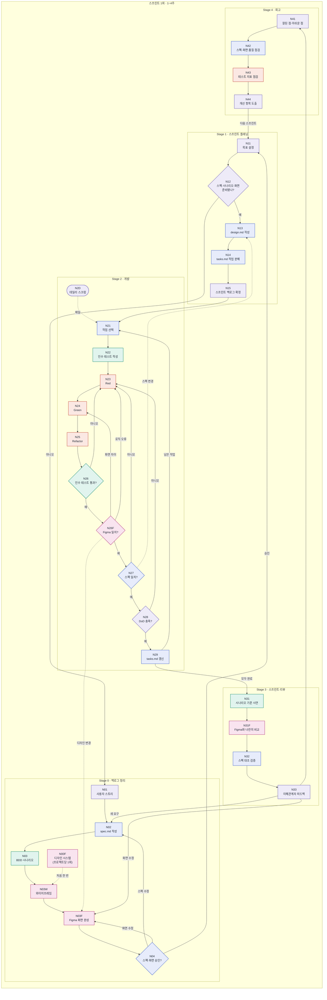

# 4DD 스프린트 워크플로우

스프린트 한 바퀴는 **Stage 0~4**로 나뉘고, 각 스테이지 안에 노드가 있습니다.

```
스프린트 (한 바퀴, 1~4주)
 └─ 스테이지 (Stage 0~4)
     └─ 노드 (N01, N26F …)
```

## 노드 맵

- 사각형: 작업 노드
- 마름모: 판단 노드
- 둥근 모양: 반복 노드 (N2D 데일리 스크럼)
- 점선: 스펙이나 디자인을 바꿔야 해서 앞 스테이지로 돌아가는 경로, 그리고 프로젝트 처음에 한 번만 거치는 경로(N00F)



색: 파랑 SDD · 초록 BDD · 분홍 Figma · 주황 TDD · 보라 스크럼

## 되돌림 경로

| 지점 | 조건 | 돌아가는 곳 | 의미 |
|---|---|---|---|
| N04 | 스펙·화면 미승인 | N02 / N03F | 스펙이나 화면을 고쳐서 다시 리뷰 |
| N12 | 스펙·시나리오·화면 없음 | N01 | 준비 안 된 스토리는 스프린트에 넣지 않음 |
| N26 | 인수 테스트 실패 | N23 | TDD 반복 |
| N26F | Figma와 불일치 | N24 / N23 / N03F | 화면 차이면 바로 구현을 고치고(N24), 로직 오류면 단위 테스트부터(N23), 디자인을 바꿔야 하면 화면으로(N03F) |
| N27 | 설계와 불일치 | N23 / N13 | 코드를 고치거나, 스펙을 바꿔야 하면 설계로 |
| N28 | DoD 미충족 | N23 | 완료 기준을 채울 때까지 작업 |
| N33 | 피드백 | N02 / N03F | 스펙이나 화면을 갱신하고 새 요구를 백로그로 |
| N44 | 회고 끝 | N11 | 다음 스프린트 시작 |

## 실패 원인과 횟수 제한

### 실패 원인

판단 노드에서 실패하면 원인을 아래 단어 중 하나로 기록합니다. 위 되돌림 경로 표는 기본 경로이고, 실제로 어디로 돌아갈지는 실패 원인으로 정합니다. 단어를 정해 두는 이유는 회고에서 원인별로 세기 위해서입니다.

| 실패 원인 | 뜻 | 예 (로그인) | 돌아가는 곳 | 승인 |
|---|---|---|---|---|
| `code_bug` | 코드가 틀림 | 5회 실패해도 잠기지 않음 | N23 | 에이전트 |
| `ui_mismatch` | 화면이 프레임과 다름 | 잠금 안내 문구 위치가 프레임과 다름 | N24 | 에이전트 |
| `spec_ambiguous` | 스펙이 모호함 | "10분 잠금"의 기준 시점이 불분명 | N02 | 사람 |
| `spec_missing_state` | 스펙에 빠진 상태가 있음 | 잠금 중 비밀번호 재설정 규칙이 없음 | N02 | 사람 |
| `design_missing_state` | 그리지 않은 화면 상태가 있음 | 네트워크 오류 화면이 없음 | N03W | 사람 |
| `test_flaky` | 테스트가 불안정함 | 같은 코드인데 결과가 바뀜 | N22 | 에이전트 |
| `env` | 실행 환경 문제 | 에뮬레이터나 빌드 도구 오류 | 사람 호출 | 사람 |
| `budget_exceeded` | 횟수 제한 초과 | 아래 참고 | 사람 호출 | 사람 |

- 앞 스테이지(스펙, 디자인)로 돌아가는 분류와 사람 호출은 사람이 승인해야 진행합니다. 에이전트가 풀기 어려운 문제를 엉뚱한 원인으로 분류해 빠져나가는 것을 막기 위해서입니다.
- 단어를 추가하려면 회고에서 승인을 받습니다.

### 횟수 제한

| 대상 | 한도 | 셈 방식 |
|---|---|---|
| 판단 노드 하나 (기본) | 3회 | 같은 작업이 같은 판단 노드에서 연속으로 실패한 횟수. 통과하면 0으로 돌아감 |
| N26F Figma 일치 | 5회 | 화면 미세 조정이 많아서 넉넉하게 둠 |
| 작업 하나 전체 | 10회 | 판단 노드 사이를 오가는 경우까지 포함한 되돌림 총합 |
| `test_flaky` | 자동 재실행 1회 | 이 재실행은 횟수에 넣지 않음 |

한도를 넘으면 `budget_exceeded`로 기록하고 다음 순서로 진행합니다.

1. 작업을 멈춥니다.
2. 시도 내역, 각 실패 원인, 마지막 차이 이미지나 오류를 요약해 남깁니다.
3. 사람을 부릅니다. 사람은 힌트를 주고 다시 시도하게 하거나, 분류를 바로잡거나, 스펙이나 디자인을 고치거나, 작업을 보류합니다.
